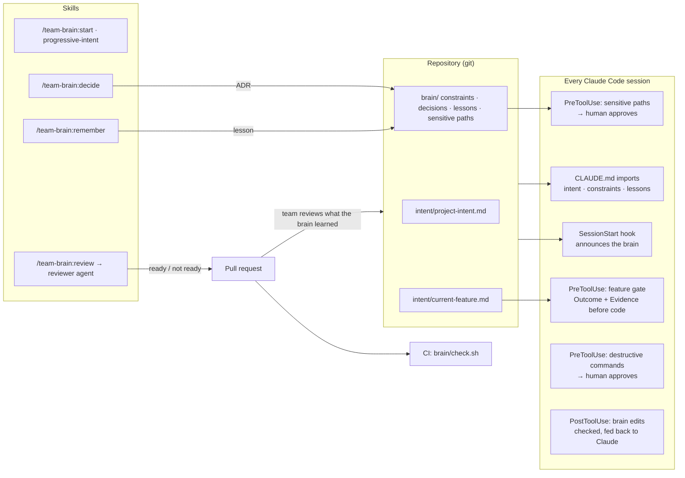

# Team Brain

**A shared, versioned team brain for any repository — built for Claude Code, readable by every AI assistant.**

Most teams using AI coding tools have one brain per developer: each person's prompts, corrections and habits live in their own session and die there. Team Brain moves that judgment into the repository. The project's intent, the rules the team agreed on, its architecture decisions and the lessons it learned sit in git, load into every Claude Code session automatically, and are enforced by hooks. When one developer corrects the AI, the whole team inherits the correction by pull request.

Built on [intent-drive-starter](https://github.com/kendallmark3/intent-drive-starter) (Progressive Intent) and the earlier [TeamBrain](https://github.com/kendallmark3/teambrain-repro) framework. Learn the methodology at [learnteachmaster.org](https://learnteachmaster.org) and [intent-driven-engineering.com](https://intent-driven-engineering.com).

## Install

```bash
/plugin install team-brain --marketplace kendallmark3/team-brain
```

Or from a shell, in two steps (works on older Claude Code versions):

```bash
claude plugin marketplace add kendallmark3/team-brain
claude plugin install team-brain@team-brain
```

Then, in any repository:

```text
/team-brain:init   <one line on what this system is for>
```

Commit what it creates as one pull request, so the team reviews its own brain. The hooks need `bash`; JSON is read with `jq`, `python3` or `node` — whichever is there.

## What lands in your repo

```
intent/project-intent.md     Purpose · Owner · Primary tradeoff · We do not · Revisit when
intent/current-feature.md    created by /team-brain:start for each feature (Outcome + Success / Evidence)
brain/constraints.md         agreed rules, each with Why:  +  named, approved, time-bound exceptions
brain/decisions.md           ADRs: what we gained, what we gave up, what we rejected, how to roll back
brain/lessons.md             one-line corrections the team does not want to repeat
brain/sensitive-paths.txt    globs where edits go to a human first
brain/check.sh               plain bash checker — no AI — run by CI
CLAUDE.md                    a managed block that @imports the brain into every session
AGENTS.md                    the same rules for Copilot, Cursor, Codex
.github/workflows/team-brain.yml
```

Everything is plain Markdown. Uninstall the plugin and the brain still works: CLAUDE.md still imports it, AGENTS.md still points to it, CI still checks it.

## How it works



### Skills

| Skill | Use it when |
|---|---|
| `/team-brain:init` | First time in a repo. Lays down the files (never overwrites), reads the repo, fills Purpose / Owner / We do not with you, tunes sensitive paths. Safe to re-run. |
| `/team-brain:start <outcome>` | Starting a feature. Smallest sufficient intent → smallest useful delta → you observe → continue or stop. |
| `progressive-intent` | You react to what was built ("keep this, change that"). Appends a delta; never rewrites the intent. |
| `/team-brain:decide` | An architecture choice, or a constraint that has to be broken. Records an ADR with a real cost, or a named exception. |
| `/team-brain:remember` | A correction the whole team should keep. One line in `brain/lessons.md`, deduplicated, landed by PR. |
| `/team-brain:review` | Before a PR. Reviews against intent, constraints, lessons, decisions and sensitive paths — via an independent reviewer agent for anything non-trivial. |

### Hooks

| Hook | Does | Leaves alone |
|---|---|---|
| SessionStart | Tells Claude the brain is active, with counts and sensitive paths | Repos without `brain/` (silent) |
| PreToolUse · Edit/Write | Blocks code edits while `intent/current-feature.md` lacks Outcome or Success / Evidence | Markdown; repos without a feature file |
| PreToolUse · Edit/Write | Sends edits matching `brain/sensitive-paths.txt` to you for approval | Everything else |
| PreToolUse · Bash | Asks before force push, `reset --hard`, `clean -f`, `branch -D`, DB drop/truncate, `terraform destroy`, broad `kubectl delete`; refuses `rm -rf /` or `~` | `--force-with-lease`; text inside quotes (`echo "drop table"`, commit messages) |
| PostToolUse · Edit/Write | When Claude edits the brain, runs the checker on that file and hands problems back | Non-brain files |

Every hook fails open: if it cannot parse its input or a tool is missing, it gets out of the way.

## What we kept, and what we dropped

This plugin keeps only what held up in practice across TeamBrain, the IDE plugin, the portable kit and intent-drive-starter.

**Kept**
- The brain is committed to the repo and loads automatically — every developer and every session inherits it.
- Constraints trace to intent (`Why:`). A constraint is never worked around silently: name it, get the owner's approval, set a deadline.
- AI recommends; a human approves anything sensitive or hard to undo.
- Architecture decisions name what they cost and what was rejected.
- Review against intent, not just the diff — from a context that did not write the code.
- A no-AI checker in CI that exits 2 from the wrong directory instead of reporting green.
- Portable files first: it must work where you cannot install plugins.

**Dropped**
- The mandatory seven-question intent check before every change → replaced by minimum sufficient intent (Outcome + Success / Evidence).
- Big constraint documents written up front → constraints are added when evidence justifies them.
- Pasting a system prompt into each session → CLAUDE.md imports.
- Stack-specific rules in the shared framework → each repo's own brain.

## Inside enterprises without admin rights

The plugin is the convenient path, not the only one. Copy `scaffold/` into a repo (or run `bash scripts/init.sh` from a clone of this repo) and you have the same brain: CLAUDE.md imports it, AGENTS.md covers other assistants, and `brain/check.sh` runs in CI. You lose the hooks; you keep the brain.

## This repository dogfoods itself

This repo has its own brain — [`intent/project-intent.md`](intent/project-intent.md), [`brain/constraints.md`](brain/constraints.md), [`brain/decisions.md`](brain/decisions.md), [`brain/lessons.md`](brain/lessons.md) — recording why it is built the way it is. Run the tests with `bash tests/run.sh` (67 cases, including runs with jq, python3 and node each missing).
